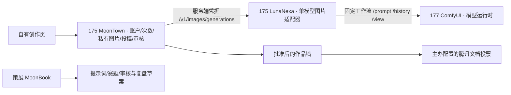

# 半醒咖啡图片链路

首期时间仍按用户确认的 2026-11-06 至 11-13，全部为北京时间。
具体截止和投票时间是当前方案：11-12 18:00 截稿，20:00 开票，11-13 16:00 关票，18:00 开奖。

## 现有概念与边界

这是一项 Contest Express 的每周创作活动。赛题继续使用既有 Challenge，
正式图片是投稿版本；主办批准后才成为公共作品。策展素材和 agent 放在私人 MoonBook。
不用数值 rubric 伪装大众投票，不把 17 张主办参考海报填成参赛或获奖记录。

生成器只接受提示词，固定 1024×1024、1 张、8 步；客户端不能提交任意 ComfyUI graph、
模型名、文件路径、参考图地址或回调 URL。模型节点不装 MoonTown/MoonBook/MoonClaw，
不保存用户账户与活动凭据。浏览器不直接访问 8188。

## 177 的资源安排与验收

2026-11-06 核对时 Qwen 配置 `--gpu-memory-utilization 0.80`，
系统 MemAvailable 约 12 GiB，GPU 利用率瞬时 0%；瞬时空闲不代表长期有余量。
GPU 的 Kubernetes allocatable 为 1，已由 Qwen 请求。

用户已明确授权下调 Qwen 到 55% 并短暂重启。2026-11-07 已执行，Qwen 重新加载约 5 分钟，
随后恢复 Ready。只对 177 使用独立 time-slicing 设备插件配置，GPU 逻辑资源为 2；
仍是一块物理 GPU，不提供内存隔离，不等于两个独立算力副本。其他三台设备插件不变。
ComfyUI 请求一个共享槽位，内存 requests=24Gi / limits=40Gi，生成并发 1。
不使用裸设备或 `NVIDIA_VISIBLE_DEVICES=all` 替代分配。

实测 1024×1024、8 步：冷态取图约 18.2 秒，换 seed 的热态约 8.1 秒；
同机短文本三次请求全部成功。小样本只说明链路和共存可行，不代表持续满载容量。
同 seed 的一次约 2 秒结果属于缓存命中，未计入真实生成速度。
内存采样在加载前约 44 GiB 可用、模型加载后最低样本约 11 GiB；这不是峰值连续监控。

## 固定工作流与运行时

优先使用 Z-Image-Turbo：扩散模型 `z_image_turbo_bf16.safetensors`、
文本编码器 `qwen_3_4b.safetensors`、VAE `ae.safetensors`。
工作流为 UNETLoader / CLIPLoader(lumina2) / CLIPTextEncode / ConditioningZeroOut /
EmptySD3LatentImage / ModelSamplingAuraFlow / KSampler(res_multistep, simple, cfg=1, steps=8) /
VAEDecode / SaveImage。seed 从持久任务 ID 确定，保存在私人运行记录中。

依据：[NVIDIA 官方 Spark 安装指南](https://github.com/NVIDIA/dgx-spark-playbooks/blob/main/nvidia/playbook-comfyui/README.md)，
[Comfy 官方 Z-Image 工作流](https://comfy.org/hub/workflows/z-image-turbo-text-to-image-eb986f4b9142/)，
[官方模型文件](https://huggingface.co/Comfy-Org/Z-Image-Turbo)。
部署前固定模型 revision、每个文件 SHA256、第三方运行时镜像 digest 与 ComfyUI 版本。
文档中的速度或安装成功不代表本集群已通过测试。

ComfyUI 只使用私有 ClusterIP 和限制来源的 NetworkPolicy。应用、原始素材、策展脚本与
活动账户不进入算力机。管理机组件继续通过现有服务入口、权限与私有凭据挂载运行。

## 开通顺序

1. 明确资源安排，保存当前 Qwen 配置与回滚记录，检查活跃和排队请求。
2. 用固定运行时和模型文件部署 ComfyUI。先做一次中文提示词真实生成，再做 Qwen 共存测试。
3. 记录输出图片哈希、冷/热启动耗时、峰值统一内存、失败与恢复行为，批准具体 node/model/runtime 组合。
4. LunaNexa 的 `cmd/image-adapter` 在管理机加载独立的配置、私有服务凭据和带 SHA256 的资格证据。
   资格证据必须明确 approved、runtime_origin、node_id、artifact_digest 和 workflow=z-image-turbo-v1；
   不制造这份批准来绕过真实验收。不同运行时绑定使用不同状态目录，旧任务保留原绑定完成核对。
5. MoonTown 配置 `MOONTOWN_CREATIVE_STATE_FILE` 与 `MOONTOWN_CREATIVE_CONFIG_FILE`，
   再填事件配置中的 provider_origin/provider_key_file。生产文件不能放进公共静态目录。
   为 443 和 8443 显式配置 `MOONTOWN_CREATIVE_ALLOWED_ORIGINS`，不信任客户端 Host/转发头扩展权限。
6. 创建持久卷，维持一个生成队列 worker；生成目录 0700、文件 0600，备份状态和图片。
7. 两个真实账户验收：A 生成/投稿 → B 看不到 → 主办批准 → B 看到 → A 撤回 → 公共链接不可读。
8. 当前使用自有预览页，明确不计票；主办可换成真实 `https://docs.qq.com/` 链接。
   正式开票前导出固定版本名单，核对手机实际能投票，不能把预览试选当成选票。

当前正式页面已发布，外网使用 8443，内网 443 已从管理机通过正确域名证书验证。
统一登录预检拒绝无效会话；双用户 UI 全链路使用隔离测试身份、真实 177 出图，
未创建正式参赛记录。真实统一账号的最终登录/主办角色验收仍需现成账号配合。
原生状态测试 2035 项、网关 8 项、浏览器脚本 180 项通过。

## 恢复和每周复用

应用和模型适配器都先持久保存意图，再提交一次生成。HTTP 超时、重启或丢响应后，
只查历史与队列，不自动再 POST。已有 provider prompt ID 或 client_id 可恢复已完成的输出。
无法核实的任务保留 needs_reconcile；主办核对模型服务确实无输出且已结束后，才退回次数。
不同 model/node/origin/profile 的状态目录不混用，避免旧任务被送到另一套运行时。

每期使用新的 Challenge ID、事件配置与状态文件，上一期保持只读归档。
当前是首期单活动配置，不是已经上线的自动周更发布系统。
MoonClaw 的 coffee_curator 准备下一期草案，主办确认后发布；不自动采购、发奖或创建投票数据。
