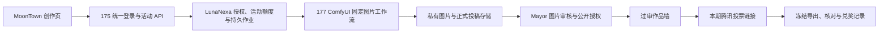

# 半醒咖啡：页面与 177 文生图接入方案

状态：2026-11-06 的设计与源码基线。2026-11-07 已完成真实 GPU 出图和页面发布，
当前状态与实测值以 `BANXING_COFFEE_IMPLEMENTATION.md` 为准。
用户明确：网页属于 MoonTown，像 MiaoEmoji 一样简单，后端用 ComfyUI，放在 177。
本方案沿用 Contest Express、统一身份、LunaNexa 作业与用量机制。

## 页面

沿用 MoonTown 的奶油白、深绿、清晰图标和中文控件。参考站公开页采用
参考图入口、风格分类与公开作品发现；点击生成需要登录，本次没有验证登录后编辑器。
借鉴简短的创作入口，不复制其品牌、样式代码或作品。

```text
← MoonTown                 半醒咖啡 · 第 1 周                 我的作品

创作                         作品墙                         活动规则

半醒咖啡                                 11 月 12 日 18:00 截稿

┌──────────────────────────┐  ┌────────────────────────────┐
│ 写下你的半醒时刻           │  │                            │
│ 一个半睁眼的原创咖啡杯……   │  │         图片预览            │
│                          │  │                            │
└──────────────────────────┘  └────────────────────────────┘
困困咖啡杯 · 周五放空 · 办公桌         重新生成       用这张参赛

生成一张
```

窄屏按提示词、生成按钮、图片、参赛按钮的顺序排。奖品和规则放在下方或规则页，
只在临近截止、审核退回、生成失败等需要处理的状态突出说明。

首版主要输入只有提示词；模板用于填入可编辑文本。主题和固定图片规格预设。
不显示租机、团队创建、工作流画布、采样器、模型切换与全镇通用评分榜。
既有团队记录可以绑定单人参赛身份，参赛界面呈现“报名/参赛”。

生成按钮触发真实异步任务，显示排队、生成中和终态。结果成功后由用户明确提交；
不自动把私有尝试公开。投稿收据包含图片预览、固定版本、提交时间及审核状态。
退回显示原因与修改操作。审核通过的正式版本才进入作品墙，投票按统一时间开放。

没有图片模型时显示“创作区准备中”；没有真实输出时不显示示意图片冒充生成结果。
“生成成功”“提交成功”“已过审”“已获奖”必须区分。

## 角色与现有概念

| 使用者 | 首要任务 | 复用与补齐 |
| --- | --- | --- |
| 参赛者 | 改提示词、出图、选一张参赛 | 统一账号、投稿收据；补轻量个人入口与生成结果绑定 |
| 主办/Mayor | 开题、处理图片审核、关票、发奖 | CompetitionProgram 日历、公告、奖品；补图片审核和兑奖记录 |
| 观众 | 看过审作品、投一票 | 公开活动页；补图片墙及投票入口 |
| 集群运营 | 控制图片工作负载与预算 | LunaNexa 授权、用量、作业恢复；补图片工作流适配和活动额度 |

## 源码核对得到的差距（11 月 6 日基线）

| 能力 | 当前情况 | 首期所需 |
| --- | --- | --- |
| 主题、日历、奖品、公告、FAQ | Contest Express 已有 | 配置第 1 期并提供中文简洁视图 |
| 身份 | 当前比赛入口只识别 Active 的 EnterpriseUser/PlatformOperator | 普通有效活动账号可参赛；不借此授予企业或管理员权限 |
| 投稿 | 已有外链、说明、版本、材料 SHA-256 | 选择生成结果即提交；图片入正式存储、哈希由服务端计算 |
| 审核 | 已有评审、证据、申诉 | 图片内容审核、公开授权与版本绑定；过审后才可公开 |
| 公共展示 | 已有信息页和评分 Champion Wall | 经授权的过审图片墙；不把评审分伪装成人气票数 |
| 文生图 | MoonTown 没有接通的图片生成链路 | 177 ComfyUI 固定工作流、真实输出与用户作业关联 |
| 媒体作业基础 | LunaNexa/MoonGate 已有托管视频代码及恢复边界 | 复用授权/持久化/计量，另做静态图片适配；视频接口不能直接当图片接口 |
| 免费活动额度 | 现有媒体基础绑定订单/工作空间等授权 | 主办方承担预算的活动授权与每人/每期/全局额度 |
| 票选 | 当前没有比赛大众投票实现 | 本期外链投票、固定名单、截止导出与人工核对 |
| 周循环与兑奖 | 日历、公告可复用 | 每周新一期、投票冻结与发奖记录的操作流程 |

当前比赛角色边界见 `src/cmd/desktop_server/hackathon_access.mbt`；材料与版本见
`src/hackathon/participation_model.mbt`；日历与奖品见 `src/hackathon/program_model.mbt`。
邻里故事的作者自主发布不等于主办方审核门槛，不能用它绕过参赛图片审核。
以上属于源码能力核对，不是生产部署验收或完成百分比。

## 177 接入



177 仍承担 Qwen 文本推理。图片与文本共享设备的容量、内存和交互影响需要实测，
不能因为 Spark 有大容量统一内存就认定两种负载可以无影响地并行。
初始图片执行并发设为 1；不挪用 178+179 的双机 GLM，也不把离线 180 计入容量。
是否需要固定图片时段，按同机 Qwen 的实测服务表现决定。

ComfyUI 服务只在受控内网由服务端调用，固定工作流模板和模型版本。
参赛者只提供长度受限的提示词，不提供节点、路径、模型名、插件或任意工作流 JSON。
ComfyUI 工作流/历史/输出目录不直接暴露给浏览器，账号隔离在活动 API、作业授权
和正式存储中保持。原有个人 ComfyUI 产品入口与这一固定活动工作流区分。

优先评估 NVIDIA Spark 官方图片入门流程中的 Z-Image-Turbo；官方模型卡标明
Apache-2.0。它是待实测候选，不是已经装在 177 上的能力。固定版本、模型文件、
依赖和工作流校验值；不能拿其他 GPU 或官方示例的速度替代本集群测量。

活动 API 负责活动身份、剩余额度、真实输出引用与提交权限；LunaNexa 保持 GPU
授权、用量和上游作业的权威。浏览器不持有管理密钥，不把共享视频试用凭据当作
免费比赛授权。主办预算承担与参赛者身份分别记录，避免要求普通用户先买算力。

生成记录至少关联账号、活动、原始提示词、模型/工作流版本、seed、作业标识、
图片引用与哈希、计量结果。公开页只取获准展示的投影；提示词是否公开另行选择。
作业重复点击使用幂等意图，执行状态不明时先核对原任务，不自动重复消耗 GPU。

## 首期容量与验收

建议 30 人定向试跑、每人本期 10 次、每次一张、固定 1024×1024；
不是无限免费生成。真实失败的用户额度可恢复，已经发生的算力成本仍如实记录。
按实测成本、排队和 Qwen 影响决定是否扩至 50—100 人。

估算公式：总 GPU 执行时长 = 成功/失败各类任务实际执行时长之和。
例如假设每张 30 秒，300 张约 2.5 GPU 小时，1000 张约 8.3 GPU 小时；
不含冷启动、排队、重试、审核，也不代表 177 的实际速度。

先验收同一版本的真实主题图片，记录冷启动、热态耗时、失败率和存储用量；
再与 Qwen 同机运行，观察文本请求延迟及稳定性。用结果确定全局任务上限、
排队容量和活动预算耗尽后的暂停行为。后台恢复、图片下载不能依赖浏览器一直打开。

上线最小闭环：

1. 普通参赛账号可以操作，匿名观众只能看已公开内容；A 不能读取 B 的草稿图。
2. 真实 177 出图，离开页面再回来仍能看到本人的任务和结果。
3. 投稿后图片进入正式留存，不依赖 ComfyUI 临时输出目录或短期下载链接。
4. 未过审、退回、撤回及修改后的未审核版本不会出现在公共墙。
5. 重复点击、失败、断连、服务重启不会悄悄再创建一份收费/耗时任务。
6. 服务端执行投稿截止；投票名单、截止与兑奖记录可导出核对。
7. 腾讯投票用两个账号验证限制和隐私，不能用公开可编辑表格决定奖项。
8. 保留 175 元数据、投稿图片和必要作业记录的独立备份，演练恢复。

175 是入口、控制和存储集中点。首期先完成备份与任务恢复，不以已有四台 Spark
宣称前台高可用。图片丢失、断电重启和截止日故障要有统一的公告/延期处理方式。

## 内容、权利与现金风险

- 对输入和输出做内容审核；人工批准不能替代生成端处理。根据适用要求完成 AI
  显式/隐式标识、下载与再传播标识；不是只在网页底部放一句说明。
- 开源模型许可证、对公众提供服务的义务和参赛作品的权利归属分别核实。
  使用开源模型不自动豁免面向公众服务的适用登记、备案或评估要求。
- 品牌主题包授权、作品公开授权和商业印制授权分开；未经同意不用于训练。
- 现金预算不含开发人工和设备固定成本。限制生成总量，先实测增量成本；
  不用免费无限出图吸引大量与本地门店无关的消耗。
- 投票作为低价值人气奖选择工具，主办独立选两个轻松奖，减少单一票数引发的争议。
  规则、奖品与履约信息在开赛前固定；争议保留原始数据和处理理由。

## 公开资料

- [MiaoEmoji 公开入口](https://miaoemoji.com/)：本次仅观察公开页与登录门槛。
- [NVIDIA Spark / ComfyUI 图片入门](https://build.nvidia.com/spark/comfyui/image-gen-quick-start)。
- [Z-Image-Turbo 官方模型卡](https://huggingface.co/Tongyi-MAI/Z-Image-Turbo)。
- [人工智能生成合成内容标识办法](https://www.cac.gov.cn/2025-03/14/c_1743654684782215.htm)。
- [生成式人工智能服务管理暂行办法](https://www.cac.gov.cn/2023-07/13/c_1690898327029107.htm)。
- [规范促销行为暂行规定](https://www.samr.gov.cn/zw/zfxxgk/fdzdgknr/fgs/art/2023/art_cae53a080be2401e8f91c6d6291539f8.html)。

私有代码依据：`../lunanexa/docs/MEDIA_GENERATION.md` 与
`../moongate/docs/MEDIA_GATEWAY.md` 说明了视频授权、作业恢复和媒体转发边界。
历史文档不作为 2026-11-06 在线部署事实；在线节点角色以用户本次提供的拓扑为准。
